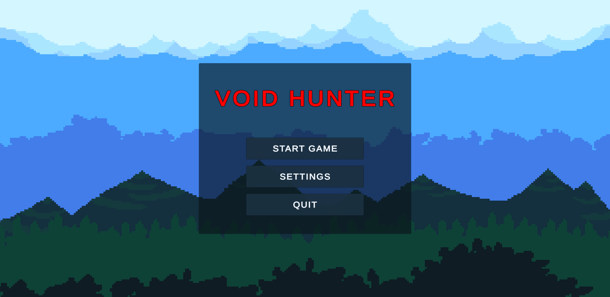
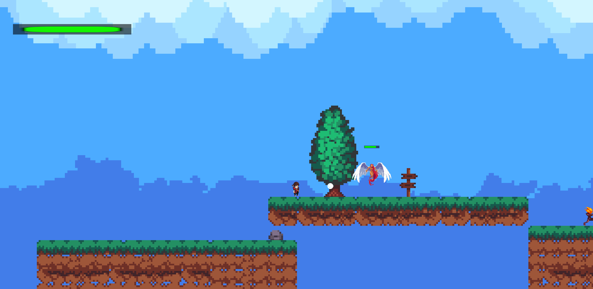
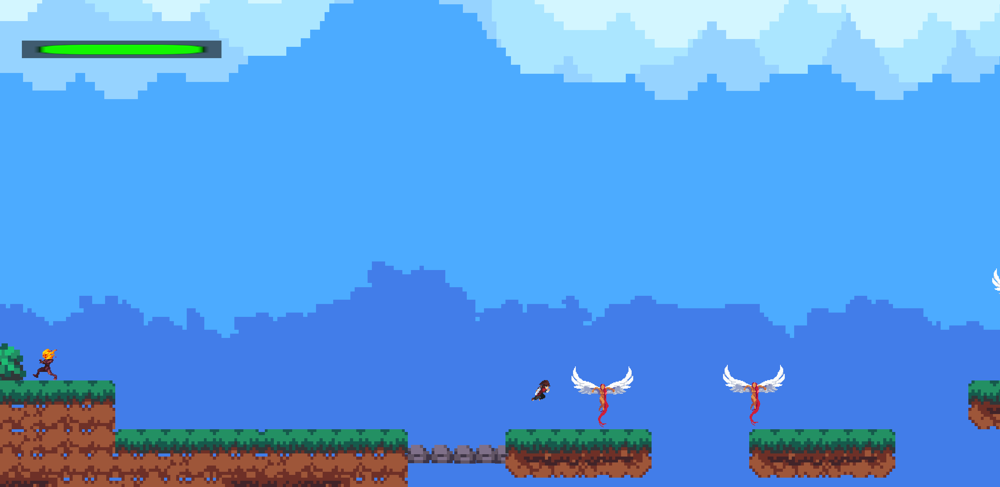
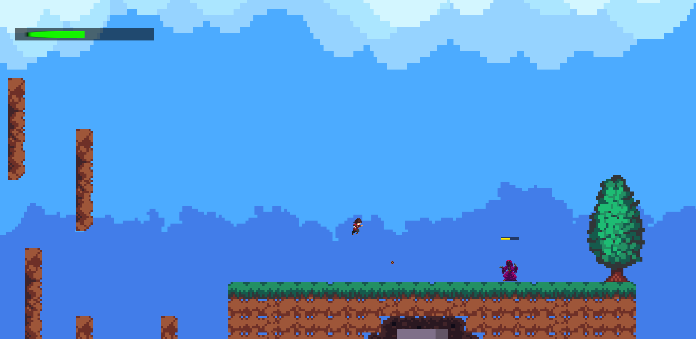
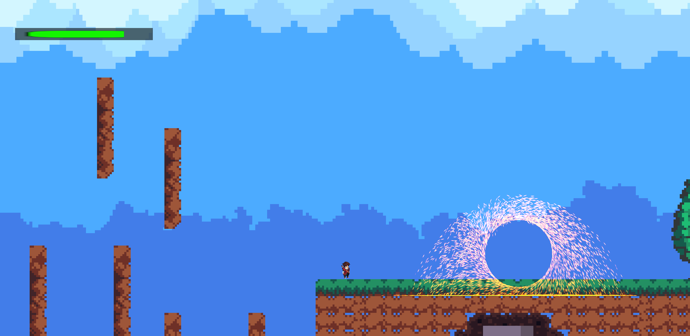
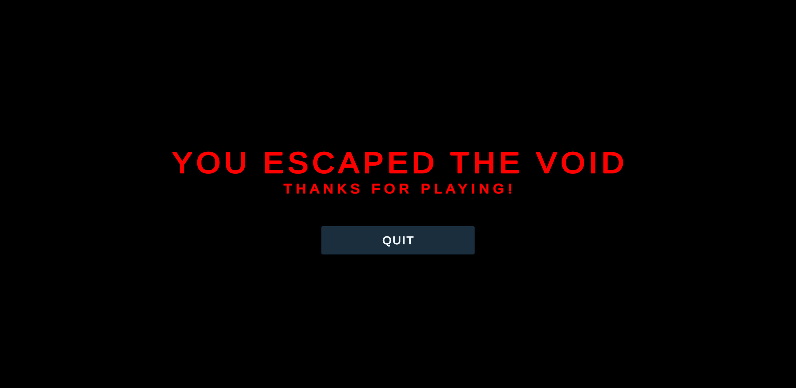

# Void Hunter

A 2D action platformer made with Unity 6 and C#. You fight your way through a dark world full of shadow creatures until you reach the portal at the end of the level.

## Features

- Running, jumping, wall sliding, wall jumps and a dash
- A fast melee attack and a ranged projectile attack
- Healing with a cooldown
- Three enemy types, each with its own AI:
  - Flying Angel: flies through the air and attacks the player
  - Burning Ghoul: chases the player on the ground
  - Wizard: casts fireballs from a distance
- The exit portal appears once the key enemies are defeated. The game ends with a camera zoom and a fade-out.
- Main menu, pause menu with volume control, game over screen with restart

## Screenshots

| | |
|---|---|
|  |  |
|  |  |
|  |  |

## Controls

| Action      | Keys                       |
|-------------|----------------------------|
| Move        | A / D or Arrow Left / Right |
| Jump        | Space                      |
| Wall jump   | Space while on a wall      |
| Dash        | Shift                      |
| Attack      | Left mouse button or Ctrl  |
| Projectile  | Right mouse button or Alt  |
| Heal        | H                          |
| Pause       | Esc                        |

## Play

Download the Windows build from the [Releases](../../releases) page, unzip it and start `Void Hunter.exe`. A full run takes less than two minutes.

## Code overview

All gameplay code is in [`Assets/Scripts`](Assets/Scripts):

| Script | Responsibility |
|--------|----------------|
| [`PlayerController`](Assets/Scripts/PlayerController.cs) | Movement, wall jump, dash, attacks, healing, animations and sounds |
| [`PlayerHealth`](Assets/Scripts/PlayerHealth.cs) | Health, damage, knockback, death |
| [`EnemyController`](Assets/Scripts/EnemyController.cs) | Enemy AI: patrol, chase, melee and ranged attacks, movement sounds |
| [`EnemyHealth`](Assets/Scripts/EnemyHealth.cs) | Enemy health and knockback, death event used by the portal |
| [`Projectile`](Assets/Scripts/Projectile.cs) | Projectiles for player and enemies, layer-based hit detection |
| [`PortalManager`](Assets/Scripts/PortalManager.cs) | Activates the exit portal once the required enemies are dead |
| [`GameEndManager`](Assets/Scripts/GameEndManager.cs) | Ending sequence: camera zoom and fade to black |
| [`GameManager`](Assets/Scripts/GameManager.cs) | Game state, game over screen, restart |
| [`CameraController`](Assets/Scripts/CameraController.cs) | Smooth camera follow with level bounds |
| [`PauseMenu`](Assets/Scripts/PauseMenu.cs) / [`MainMenuManager`](Assets/Scripts/MainMenuManager.cs) | Menus and volume settings |

## Tech

- Unity 6, Universal Render Pipeline 2D
- C#, Rigidbody2D physics, Tilemaps, Animator state machines
- Physics movement runs in `FixedUpdate`, input is read in `Update`
- Enemy deaths are sent as static C# events, so the portal logic does not depend on the enemy scripts

## Open in Unity

1. Clone the repository.
2. Open the folder in Unity Hub with a Unity 6 version.
3. Open `Assets/Scenes/MainMenu.unity` and press Play.

## Credits

Graphics and sound effects come from free asset packs. All rights belong to their creators.

Game design, programming and level design by Saltuk Kalender.
